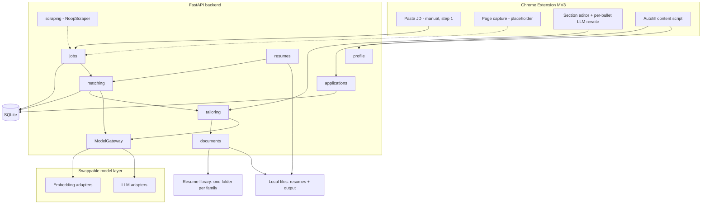
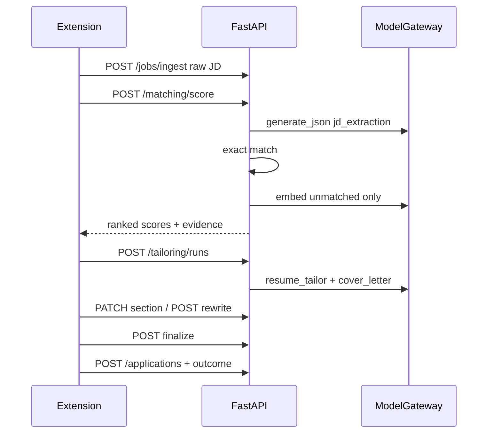
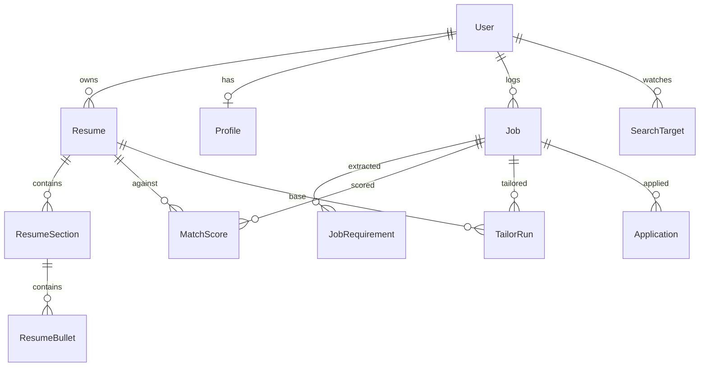

# AI Job Application Assistant — Architecture

This document is the source of truth for how the system is built. Read it before changing scoring, providers, ingestion, tailoring, or the Chrome extension.

The product follows the FigJam board *Job application — Automation*: ingest a job (manual paste today, scraping later), score it against versioned base resumes (`.tex` or `.docx`), optionally tailor with an LLM, let the user edit line-by-line, render a final document **in the format it was uploaded in and with its layout intact**, file it in the local resume library, autofill an application, and log the outcome.

---

## Standing rules

1. **Nothing outside `backend/app/modules/ai/` imports a provider class or hardcodes a model name.** Callers ask `ModelGateway` for a *task*. Config decides which `provider:model` serves it.
2. **The LLM never scores.** Tier 0 extracts a structured requirement list. Tiers 1 and 2 compute the score.
3. **Tier 2 embeddings run only on tier-1 misses.** Exact keyword match is the first pass and makes no API calls.
4. **Embedding vectors are namespaced by `provider:model:dimensions`.** That namespace is part of the cache key and is stored on every `MatchScore`. Changing embedding models must recompute, never mix vector spaces.
5. **Manual JD paste is the first working ingestion path.** Web scraping and page capture exist as wired placeholders.
6. **A base resume is edited in its own format, never converted.** `.tex` is parsed into preamble + sections + bullets and reassembled. `.docx` is edited **in place**: the upload is the template, and tailored text is written into the runs that are already there.
7. **The layout of the uploaded document is a contract.** The title block, section headers, Education, and any line that pushes text to the right margin are frozen. The model is only ever shown the lines it may change, and the writer refuses a frozen locator even if a caller asks. See [Format preservation](#format-preservation).
8. **The user selects the resume.** Scoring may recommend a family; `preferred_resume_id` on the profile is the default the user marked. Applications always store the resume the user chose.
9. **Finalize writes to `OUTPUT_DIR`; auto-apply files to the library and logs the tracker.** `RESUME_LIBRARY_ROOT` holds one folder per resume family, and that is where a finished resume lands.
10. **One application per job + resume.** `POST /applications` and auto-apply both go through `applications/service.upsert_application`, so logging the same pair twice updates that row instead of adding a duplicate.

---

## System context



---

## End-to-end user flow

1. User uploads up to two versions in each family (`ai_ml`, `data_science`, `data_analyst`, `business_analyst`), as `.tex` or `.docx`. The parser stores sections + bullets (plus the preamble for `.tex`). `POST /resumes/{id}/reparse` re-runs the parser over a stored file after a parser change.
2. User pastes a JD in the extension (or `POST /jobs/ingest`). Paste is the only input at this step; company, role, sponsorship, date posted, and apply link are collected later, when the application is logged (`PATCH /jobs/{id}`).
3. `POST /matching/score` runs:
   - **Tier 0** LLM extraction → `job_requirements` (cached per job).
   - **Tier 1** exact keyword match against resume chunks.
   - **Tier 2** embedding match only for unmatched requirements.
   - Scorer ranks base resumes. Winner is `jobs.recommended_resume_id` (Select base resume).
4. User chooses whether to tailor. If yes, `resume_tailor` + `cover_letter` run in parallel via the gateway. `resume_tailor` receives only the **editable lines**, each tagged with an id, and returns `{id, text}` edits. Personalized instructions are appended.
5. User edits or rewrites individual lines with `bullet_rewrite`. Finalize renders in the base resume's format into `OUTPUT_DIR`: `.tex` (+ PDF if a compiler exists) or an in-place edited `.docx` (+ PDF if LibreOffice exists).
6. Auto-apply: `POST /tailoring/runs/{id}/auto-apply` does two things. It copies the documents into `RESUME_LIBRARY_ROOT/<Family>/` as `<uploaded filename>_<company>`, and it writes the tracker record — company, role, date applied, status, whether the resume was tailored, resume family, and the saved file's path.
7. Apply: autofill uses `/profile` personal data. `POST /applications/{id}/outcome` logs succeeded/failed plus timestamp.



---

## Format preservation

The tailored document must be openable next to the original and look like the same
file. Three design choices carry that guarantee, and each is enforced in code rather
than left to the model.

### 1. The upload is the template

`.docx` is never rebuilt. [`documents/docx_writer.py`](backend/app/modules/documents/docx_writer.py)
opens the uploaded file and replaces text inside the runs that already exist, so
paragraph properties (indentation, spacing, alignment, list numbering, tab stops)
and run properties (font, size, bold, colour) are carried over because nothing
touches them.

Within a paragraph only the changed span is rewritten: the runs covering the
unchanged head and tail are left alone. That is what keeps a bolded `Languages:`
label bold when only the list after it changes.

`.tex` gets the equivalent treatment. `\section{...}` is split into `header_latex`
and never handed to the model, and an edited bullet is spliced back into its own
section by matching the untouched `latex_original`.

### 2. Only editable lines are offered to the model

[`resumes/docx_parser.py`](backend/app/modules/resumes/docx_parser.py) addresses every
paragraph by its index in document order (`locator`) — tables included, since many
templates lay the page out in one — and marks what may change:

| Frozen | Why |
|--------|-----|
| `title block` | Everything above the first confidently named section header. The name line is not a section, even when it is short and bold. |
| `section header` | Its own paragraph, never offered for editing. |
| `frozen section` | Education, certifications, licences. Degrees, schools, and dates are facts. |
| `column alignment` | The line pushes text to the right margin with tabs **or** a run of 3+ spaces. Re-flowing it would move the date. |
| `job title or employer line` | A short non-bullet line with no colon and no comma. A skills line has one or the other, so it stays editable. |
| `layout element` | Image, hyperlink, field, or manual break that a text-level replacement cannot preserve. |

`build_tailor_items_prompt` shows the model only the editable lines, numbered.
Frozen text goes in as read-only context so tailoring stays coherent. The prompt
also caps rewritten length at roughly the original, because a bullet that grows
from one line to three reflows the page even when every style is intact.

### 3. The writer refuses, it does not trust

`write_docx` re-checks both invariants at write time: a frozen locator is never
written, and a right-aligned line is never re-flowed. Refusals surface on
`TailorRun.compiler_warning` instead of silently changing the document.

Section names for `.docx` are matched against a vocabulary of real resume headings
first (`SECTION_VOCABULARY`), because bold-and-caps heuristics vary wildly between
templates. A Heading *style* only counts as a header when the line is also short
and not right-aligned — templates hand Heading styles to employer and school lines
too.

---

## Repository layout

```
backend/app/
  core/          config, deps, auth token
  db/            SQLAlchemy engine, Alembic scaffold
  common/        storage + repository ports and adapters
  modules/
    ai/          ModelGateway, registry, adapters, prompts  (the only place providers live)
    resumes/     upload/delete/reparse, parsed.py shape, latex_parser, docx_parser
    jobs/        ingest + metadata
    matching/    tiers 0/1/2 + scorer
    tailoring/   tailor yes/no, line edit, rewrite, finalize, auto-apply
    documents/   renderer (.tex + in-place .docx), docx_writer, pdf, library
    applications/apply + outcome
    profile/     personal data for autofill
    scraping/    SearchTarget + NoopJobBoardScraper
    auth/ users/
extension/       vanilla MV3 popup wizard
ARCHITECTURE.md  this file
```

The old `pipeline` and `chat` modules were removed. Tailoring replaced pipeline.

---

## Provider-agnostic model layer

### Why task routing, not one global model

Cheap JSON extraction and high-quality tailoring want different models. Each task resolves a `provider:model` spec, falling back to a default:

| Task | Settings field | Default |
|------|----------------|---------|
| `jd_extraction` | `LLM_JD_EXTRACTION` | `LLM_DEFAULT` |
| `resume_tailor` | `LLM_RESUME_TAILOR` | `LLM_DEFAULT` |
| `bullet_rewrite` | `LLM_BULLET_REWRITE` | `LLM_DEFAULT` |
| `cover_letter` | `LLM_COVER_LETTER` | `LLM_DEFAULT` |
| `requirement_embedding` | `EMBEDDING_REQUIREMENT` | `EMBEDDING_DEFAULT` |
| `resume_embedding` | `EMBEDDING_RESUME` | `EMBEDDING_DEFAULT` |

Example: point extraction at a local model while tailoring stays on Gemini Pro:

```
LLM_DEFAULT=gemini:gemini-1.5-flash
LLM_JD_EXTRACTION=ollama:llama3.1
LLM_RESUME_TAILOR=gemini:gemini-1.5-pro
EMBEDDING_DEFAULT=gemini:text-embedding-004
```

`GET /models` reports registered providers and the resolved routing so you can confirm a swap.

### Ports

Defined in [`backend/app/modules/ai/ports.py`](backend/app/modules/ai/ports.py):

- `LLMProvider.generate(prompt, system=, json_mode=) -> LLMResponse`
- `EmbeddingProvider.embed(texts) -> EmbeddingResult` with `namespace = provider:model:dimensions`
- `ModelCapabilities` (`supports_json_mode`, `supports_system_prompt`, `max_input_tokens`, `dimensions`)

### Registry and gateway

- `@register_llm("name")` / `@register_embedding("name")` in [`registry.py`](backend/app/modules/ai/registry.py)
- [`ModelGateway`](backend/app/modules/ai/gateway.py) is the only object application code should construct or inject (`get_model_gateway` in deps)
- [`structured.py`](backend/app/modules/ai/structured.py) uses native JSON mode when advertised, otherwise fence-strips and does one self-repair retry against the Pydantic schema
- [`middleware.py`](backend/app/modules/ai/middleware.py) wraps every adapter with retry + usage logging (`model_calls` table)

SDK imports are lazy inside each adapter. Missing optional extras (`openai`, `sentence-transformers`) fail only when that provider is actually selected.

### Built-in adapters

| Kind | Names | Notes |
|------|-------|-------|
| LLM | `gemini`, `openai`, `ollama`, `fake` | Gemini is the default. Ollama uses stdlib urllib. Fake is deterministic for tests. |
| Embedding | `gemini`, `openai`, `sentence_transformers` (alias `sbert`), `fake` | Gemini `text-embedding-004` is the default. Fake is bag-of-words hashing. |

### Add a new model provider (playbook)

1. Create `backend/app/modules/ai/providers/llm/<name>.py` (or `providers/embeddings/`).
2. Implement the port. Import the vendor SDK **inside** `generate` / `embed`, not at module top.
3. Decorate with `@register_llm("name")` or `@register_embedding("name")`.
4. Declare honest `ModelCapabilities`.
5. Import the module from `providers/__init__.py` so the decorator runs at startup.
6. Point a task at it: `LLM_JD_EXTRACTION=name:model-id` (no code changes in callers).
7. Add the SDK to comments in `requirements.txt` as an optional extra.
8. `GET /models` should list the new name. The contract tests parametrize over the registry automatically.

Do **not** edit `deps.py` or matching/tailoring to mention the new vendor.

### Embedding-space safety

`embedding_cache` is keyed on `sha256(text) + namespace`. `MatchScore.embedding_namespace` records which space produced the score. After changing `EMBEDDING_DEFAULT`, old cache rows are simply unused; new rows are written under the new namespace.

---

## Three-tier scoring contract

Package: [`backend/app/modules/matching/`](backend/app/modules/matching/).

| Tier | Module | Cost | When it runs | What it returns |
|------|--------|------|--------------|-----------------|
| 0 | `extraction.py` | 1 LLM call per job (cached) | Once, on first score | `job_requirements` rows. **Not a score.** |
| 1 | `exact.py` | CPU only | Every score | `hits` + `unmatched` |
| 2 | `semantic.py` | Embedding batch | Only if `unmatched` is non-empty | hits above `SEMANTIC_THRESHOLD` |
| — | `scorer.py` | CPU only | Always | coverages + `total_score` + evidence |

### Tier 0

Prompt: extract short phrases, classify `must_have` vs `nice_to_have`. Validated by `RequirementList`. Persisted; subsequent scores reuse the rows.

### Tier 1

Normalize (casefold, punctuation → space, alias table in `aliases.py`). Word-boundary n-gram containment so `R` does not match `React`. Aliases include `k8s→kubernetes`, `sklearn→scikit-learn`, `js→javascript`, etc.

### Tier 2

Embed unmatched requirement strings (`requirement_embedding`) and resume section/bullet chunks (`resume_embedding`). Max cosine similarity vs `SEMANTIC_THRESHOLD` (default `0.72`). This is what can match “computer vision” to “image classification” when the embedding space actually encodes that synonymy.

### Aggregation

```
must_have_coverage  = weighted hit factors of must-haves
nice_to_have_coverage = same for nice-to-haves
hit factor          = 1.0 for tier 1; TIER2_CONFIDENCE_FACTOR * similarity for tier 2
total_score         = (MUST_HAVE_WEIGHT * must + NICE_TO_HAVE_WEIGHT * nice) / (mw + nw)
```

Defaults: must-have weight `1.0`, nice-to-have `0.4`, tier-2 factor `0.85`. Empty must-have list ⇒ coverage `1.0`.

Evidence JSON on `MatchScore` lists each requirement, tier (`1`, `2`, or `0` for miss), matched resume text, and similarity.

`rank_base_resumes` scores every active resume for the user and sets `recommended_resume_id`.

---

## Data model



Important columns:

- `resumes`: `family`, `version` (1–2), unique `(user_id, family, version)`, `template_preamble`, `source_format`
- `jobs`: `company_name`, `role`, `sponsorship`, `date_posted`, `application_link`, `source` (`manual`/`scraped`/`captured`), `recommended_resume_id`
- `match_scores`: coverages, `embedding_namespace`, `evidence_json`
- `embedding_cache`: unique `(text_sha256, namespace)`
- `tailor_runs`: `status` (`draft`/`ready`/`finalized`/`auto_apply`), `do_tailor`, `personalized_instructions`, `sections_json`, `final_latex`, `final_tex_key`, `final_docx_key`, `final_pdf_key`, `export_dir`, `exported_*_path`
- `applications`: `status` (`draft`/`auto_apply`/`applied`/`failed`), `autofill_payload`, `outcome`, `applied_at`, `status_updated_at`, plus the record copied at log time: `company_name`, `role`, `resume_family`, `resume_tailored`, `document_path`. Those five are derivable by joining today, but the tracker is a historical record and must still read correctly after the job is edited or the resume replaced. `applied_at` is stamped once, when auto-apply hands the resume over, and does not move afterwards.
- `model_calls`: task, provider, model, tokens, latency, success

`sections_json` is the editable snapshot for a run. For `.tex` and `.docx` it is built by
**reparsing the stored upload**, not read from the DB, so every line carries the
`locator`, `editable`, and `original_text` the renderer needs. The DB sections exist for
scoring.

Schema is created with `Base.metadata.create_all()` for local SQLite. `_patch_sqlite_columns`
in `main.py` adds later columns to an existing local DB (see `PROFILE_SQLITE_COLUMNS`,
`TAILOR_RUN_SQLITE_COLUMNS`, `APPLICATION_SQLITE_COLUMNS`). Alembic is scaffolded; a baseline migration is follow-up work. Local `backend/app.db` is gitignored and can be deleted to recreate.

---

## Ports and adapters

| Port | Current adapter | Future |
|------|-----------------|--------|
| `LLMProvider` | Gemini / OpenAI / Ollama / Fake | any `@register_llm` |
| `EmbeddingProvider` | Gemini / OpenAI / SBERT / Fake | any `@register_embedding` |
| `ResumeStorage` | `LocalResumeStorage` | `S3ResumeStorage` (stub) |
| `*Repo` | `SqlAlchemy*Repo` | same, swap engine to Postgres |
| `JobBoardScraper` | `NoopJobBoardScraper` | real board adapter |
| `DocumentRenderer` | `LatexPdfRenderer` | same; needs `tectonic` or `pdflatex` on PATH |
| DOCX write | in-place `write_docx` (python-docx) | same |
| DOCX → PDF | LibreOffice headless; Word opt-in | any converter behind `docx_to_pdf` |
| Auth | hardcoded test token | JWT later |

Database: SQLite now, Postgres/RDS later — repository interfaces stay.

---

## HTTP API

Auth: `Authorization: Bearer test-token` after `POST /auth/login`.

| Method | Path | Purpose |
|--------|------|---------|
| GET | `/health` | liveness |
| POST | `/auth/login` | test token |
| GET | `/auth/me` | current user |
| GET | `/models` | registered providers + task routing |
| POST | `/resumes/upload` | multipart `file` + form `family`, `version` |
| GET | `/resumes` | list with sections |
| GET | `/resumes/{id}` | one resume |
| POST | `/resumes/{id}/reparse` | re-run the parser over the stored file |
| DELETE | `/resumes/{id}` | delete file + rows |
| POST | `/jobs/ingest` | paste JD (+ metadata) |
| GET | `/jobs` | list |
| PATCH | `/jobs/{id}` | company, role, sponsorship, date posted, apply link |
| GET | `/jobs/{id}` | one job |
| POST | `/matching/score` | `{job_id, resume_id?}` rank or single |
| POST | `/tailoring/runs` | `{job_id, resume_id, do_tailor, personalized_instructions}` |
| GET | `/tailoring/runs/{id}` | draft |
| PATCH | `/tailoring/runs/{id}/sections/{section_id}` | manual edit |
| POST | `/tailoring/runs/{id}/sections/{section_id}/rewrite` | LLM rewrite (`bullet_index` optional) |
| POST | `/tailoring/runs/{id}/finalize` | render into `OUTPUT_DIR` in the base resume's format |
| POST | `/tailoring/runs/{id}/auto-apply` | `status="auto_apply"` + file into the family folder |
| PUT | `/profile` | upsert personal data |
| GET | `/profile` | read |
| GET | `/applications/autofill-payload` | profile dict for the content script |
| POST | `/applications` | create |
| PATCH | `/applications/{id}` | status |
| POST | `/applications/{id}/outcome` | `{succeeded: bool}` |
| GET | `/applications` | list |
| POST | `/scraping/targets` | watchlist |
| GET | `/scraping/targets` | list |
| POST | `/scraping/search` | placeholder search |

---

## Web packet (`GET /`)

Served from [`backend/app/web/`](backend/app/web/). Four folder tabs, no separate frontend build:

| Tab | What it does |
|-----|----------------|
| Personal information | `PUT /profile`. Contact, salary (base + $10k range), education, work-auth/EEO Yes/No fields. Autofill (`GET /applications/autofill-payload` and the extension content script) maps them onto application forms. |
| Job search | Lists `GET /jobs`. `POST /scraping/search` is the placeholder. Manual paste still works. User must pick a resume before Score, **Tailor and file in library**, or Add to tracker. |
| Resume store | 4 families × 2 versions, `.tex` or `.docx`. Upload/delete. **Use this resume** writes `preferred_resume_id`. |
| Tracker | `GET /applications`. Columns: company/role, resume type, tailored Yes/No, status, date applied, saved document. Reads the fields stored on the row and falls back to a job/resume join for entries logged before those columns existed. Succeeded/Failed → `POST /applications/{id}/outcome`. |

Open [http://localhost:8000/](http://localhost:8000/) while uvicorn is running.

## Chrome extension ↔ API contract

Vanilla MV3 in [`extension/`](extension/). No build step. Load unpacked.

Popup wizard:

1. **Paste JD** (required first step, JD only) → `POST /jobs/ingest` `source=manual`
2. Score cards → `POST /matching/score`. The same step holds the resume store: `POST /resumes/upload` and `DELETE /resumes/{id}`, then a rescore
3. Tailor yes/no + instructions → `POST /tailoring/runs`
4. Line editor + per-line rewrite → PATCH / rewrite; Finalize. Frozen lines render greyed with the reason they are locked, and the API rejects an edit to one
5. Company, role, sponsorship, date posted, apply link come first, because the company names the saved file and lands on the tracker row. Save to resume library → `PATCH /jobs/{id}` then `POST /tailoring/runs/{id}/auto-apply`, which files the documents and logs the tracker record; Autofill this tab → inject `src/content/autofill.js`; Mark applied → `POST /applications` (updates the row auto-apply created); Succeeded/Failed → `POST /applications/{id}/outcome`

Options page stores `apiBase` + token and edits `/profile`.

The extension and the web packet are two views of one store. Both call the same `/resumes` endpoints, so an upload or delete on either side shows up on the other: the popup reads `/resumes` each time it opens (plus a **Refresh from server** button), and the web packet re-reads when its tab becomes visible again.

`src/content/capture.js` is a no-op placeholder for the board's Automated JD branch.

---

## Placeholder inventory

These are wired end-to-end so only the adapter/body needs filling in later:

| Piece | What exists today | How to complete |
|-------|-------------------|-----------------|
| Web scraping | `POST /scraping/search` + `NoopJobBoardScraper` returns `[]` | Implement `JobBoardScraper` and set `SCRAPER_PROVIDER` |
| Page capture | `extension/src/content/capture.js` logs a message | Read ATS DOM, `POST /jobs/ingest` with `source=captured` |
| S3 storage | `S3ResumeStorage` raises `NotImplementedError` | Implement upload/presign; set `STORAGE_BACKEND=s3` |
| PDF compile | Writes `.tex`; PDF if `tectonic`/`pdflatex` exists | Install a compiler; `LATEX_COMPILER` |
| DOCX → PDF | Writes `.docx`; PDF needs LibreOffice | `brew install --cask libreoffice`, or `DOCX_PDF_CONVERTER=word` |
| PDF/DOC upload | Stored, not parsed (`.docx` and `.tex` are) | Add a parser producing `ParsedResume` |
| OpenAI / SBERT / Ollama | Adapters registered, optional deps | Set the spec + credentials / extra package |
| Alembic versions | `env.py` imports models, no revision files | `alembic revision --autogenerate` when leaving `create_all` |
| Auth | Test username/password/token | Replace `core/security.py` |

---

## Config reference

See [`backend/.env.example`](backend/.env.example). Per-provider credentials are only required when a spec actually selects that provider.

Scoring knobs: `SEMANTIC_THRESHOLD`, `MUST_HAVE_WEIGHT`, `NICE_TO_HAVE_WEIGHT`, `TIER2_CONFIDENCE_FACTOR`.

Paths: `LOCAL_STORAGE_PATH` (uploads), `OUTPUT_DIR` (finalize output), `RESUME_LIBRARY_ROOT` (auto-apply destination).

Documents: `LATEX_COMPILER`, `DOCX_PDF_CONVERTER` (`auto`/`soffice` use LibreOffice, `word` drives Word over AppleScript and can block on its dialogs, `off` skips the PDF).

Library folders, from `documents/library.py`:

| Family | Folder |
|--------|--------|
| `ai_ml` | `AI ML` |
| `data_science` | `Data Science` |
| `data_analyst` | `Data Analyst` |
| `business_analyst` | `Business Analyst` |

---

## Tests

From `backend/`:

```
pip install -r requirements.txt
pytest
```

All tests force `fake:fake` providers (no network):

- tier-1 aliases and word boundaries
- tier-2 invoked only for unmatched requirements
- scorer weights and tier-2 discount
- LaTeX parse / reassemble round-trip, frozen headers and Education, bullet splicing
- DOCX: what the parser freezes, that the writer keeps every frozen line and all run
  formatting, that a right-aligned line is never re-flowed, and a full
  upload → tailor → finalize → auto-apply run that diffs the output against the upload
- API smoke: upload → ingest → score → tailor → finalize → apply → outcome
- provider-swap purely via env
- contract test parametrized over every registered adapter

---

## Local run

```
cd backend
python -m venv .venv
source .venv/bin/activate
pip install -r requirements.txt
cp .env.example .env   # set GOOGLE_AI_API_KEY for real Gemini calls
uvicorn app.main:app --reload
```

Load `extension/` as an unpacked Chrome extension. Upload a `.tex` or `.docx` resume before scoring.

For PDF output next to the tailored `.docx`, install LibreOffice:

```
brew install --cask libreoffice
```

To run the API fully offline, set:

```
LLM_DEFAULT=fake:fake
LLM_RESUME_TAILOR=fake:fake
EMBEDDING_DEFAULT=fake:fake
```
