# Autonomous preparation and approved application execution

## Design

The Jobright investigation established a useful separation: job catalog/retrieval, resume matching and document preparation, and ATS-specific browser execution. This implementation follows those responsibilities without copying Jobright's proprietary code or claiming knowledge of its private crawlers.

```mermaid
flowchart LR
    Sources[Public ATS and job feeds] --> Discovery[Scheduled discovery]
    Discovery --> Queue[(Durable candidate queue)]
    Queue --> Score[Existing exact and embedding scorer]
    Score --> Prepare[Tailor permitted lines and write cover letter]
    Prepare --> Review[Review and edit documents]
    Review --> Approval[Content-bound approval]
    Approval --> Extension[Browser claim and autofill]
    Extension --> Confirm[Employer confirmation or manual attention]
    Confirm --> Tracker[Application tracker]
```



`backend/app/modules/agent/` owns plans, discovery adapters, queue transitions, approvals, browser leases, document transfer, and the worker. Existing matching and tailoring modules remain authoritative; callers still use `ModelGateway` task routing. An LLM never computes the score. All LLM tasks default to the authenticated ChatGPT Responses API. Semantic matching uses local `sentence-transformers/all-MiniLM-L6-v2` embeddings. Legacy Gemini configuration migrates to these defaults; no workflow request is sent to Gemini. Task/provider settings remain configurable for offline tests and explicit alternatives.

## Discovery and persistence

A user chooses sources, roles, locations, a base resume, score threshold, instructions, interval, and bounded model-work budget. Sources are public Greenhouse, Lever, Ashby, Workday CXS, Remotive, or credentialed Google Jobs through SerpApi. Public board responses are normalized to a common Posting. Fixed API hosts and validated identifiers restrict source URLs. Google Jobs follows bounded pagination and prefers an employer link where available. The connectors are not an exhaustive whole-web crawler.

Source failure is isolated; other sources continue. Failed provider details are surfaced without storing credential-bearing request URLs. GET retries are bounded for transient failures; submission is never retried. Canonical application URLs remove tracking parameters while preserving job identity parameters. A database unique constraint prevents the same user/URL from entering the queue twice. This does not merge differently hosted copies of one job; neither source disappearance nor a failed fetch is treated as proof that a job closed.

Each item retains source identity, external ID, internal job ID, timestamps, selected resume, score evidence, attempt count, preparation state, run ID, and approval/execution state. Changes to a rediscovered JD invalidate its requirement cache and approval and trigger new preparation. Reviewed packets are not silently replaced during execution or after submission. Closed-page messages are checked by the browser, but there is no universal freshness guarantee.

## Worker operation

The API lifespan starts one daemon worker by default. Every ten seconds it finds enabled plans; each due plan is acquired by an atomic database update with a two-hour preparation lease. A run persists discovered jobs and prepares at most `max_prepare` items. Remaining jobs wait for a later scan. Failed preparation is retried up to three times, then needs a user-requested reprepare. A crashed preparation can resume after its lease expires.

Set `AGENT_WORKER_ENABLED=false` to disable the embedded worker. For a separate continuously running process, use:

```sh
cd backend
AGENT_WORKER_ENABLED=false .venv/bin/uvicorn app.main:app --host 127.0.0.1 --port 8000
# A second terminal/process with the same .env and persistent database:
.venv/bin/python -m app.modules.agent.worker
```

Use a service manager/container restart policy for an unattended installation. SQLite data and output files must be persistent. Stopping the backend stops discovery/preparation; stopping Chrome stops browser application execution. Chrome alarms have scheduling jitter and require Chrome to be running.

## Documents

DOCX edits use original paragraph/run locators. Frozen headers, title/contact data, Education, alignment lines and unsupported layout elements stay untouched. Only `word/document.xml` is replaced in the ZIP; all other entry payloads are copied from the upload, including themes, styles, images and headers. Automated preparation refuses oversized or alignment-changing edits, preserving the old line and reporting that choice. Character budget is a conservative guard, not a rendered-width proof. The manual editor intentionally permits user revisions; review their output.

LaTeX finalization starts with the original source and replaces uniquely located editable bullet text. Surrounding whitespace and macros are not reassembled. Ambiguous locators stop finalization. PDF generation requires an external compiler; a missing compiler prevents attaching raw `.tex` as a resume.

Cover letters have different content/structure from a resume. The default DOCX letter retains the title block and document styling; an optional letter template provides exact letter layout around `{{cover_letter}}`, even if the placeholder spans runs. Nonbody package parts remain intact. LaTeX letters retain the preamble/title context and require compilation for an attachable PDF. A packet editor can revise the cover text and upload a letter template before finalizing again.

No arbitrary-PDF visual reconstruction is attempted. No guarantee of identical line wrapping or pagination is made for changed prose. Fixtures test ZIP payload preservation, frozen text, typography, spacing and tabs; the sample DOCX resume and letter were rendered with LibreOffice and visually inspected.

## Approval and submission state machine

```text
discovered → preparing → ready → approved → filling → submitted
                  ↘ failed             ↘ needs_attention
                  ↘ below_threshold
ready / approved → rejected
needs_attention → submitted          (explicit user confirmation)
needs_attention → ready              (user verifies no submission; approve again)
```

Preparation never creates an applied tracker record. Approval computes a digest over the selected resume ID, job description, canonical URL, editable run snapshot, cover text, profile, and actual generated document bytes. Claiming and the final pre-submission check validate it again and atomically changes approved to filling with a random 15-minute lease. Concurrent claimers cannot both take that row. Authenticated document transfer revalidates the digest when a browser lease is supplied. Subsequent edits invalidate approval.

A browser lease that expires becomes needs_attention. No automatic retry is possible after an uncertain submission. The user must check employer history and explicitly confirm receipt or confirm that no submission occurred. Only a confirmed submitted result (browser or user) writes an applied tracker record through the existing upsert service.

The legacy `/tailoring/runs/{id}/auto-apply` route is retained for compatibility: it files documents and logs the legacy status; it does not send an employer application. The new Agent workflow does not use that route. Manual packets can enter the new queue with `/agent/from-run/{id}` after finalization.

## Extension execution

The background service worker handles API credentials, queue claims, file retrieval, and tab creation. It wakes once per minute and processes one approved packet at a time, with an immediate popup command. Content scripts never receive the backend bearer token. The worker uses an isolated-world script to execute native setters/events, select/radio/checkbox handlers, file inputs, bounded dynamic-field rescans, open shadow-root controls, and exact-match combobox options. It does not overwrite existing text.

| Platform or condition | Behavior |
|---|---|
| Recognized Greenhouse, Lever, Ashby forms | Fill known native/standard controls, attach selected artifacts, attempt one unambiguous final submit, look for confirmation |
| Workday, custom company domains, other ATS | Fill recognized controls; manual navigation/final submission required |
| LinkedIn/Indeed Easy Apply | No dedicated multi-step adapter; use portal result to reach employer application or apply manually |
| Unknown required question or unsupported custom control | Pause; provide missing/skipped fields |
| File accept mismatch | Do not attach the wrong type; pause if required |
| CAPTCHA, login, redirects, failed validation | Manual attention; no bypass |
| Cross-origin embedded application | Manual attention; no automatic iframe execution |
| Submission navigates away before confirmation | Uncertain outcome; user checks employer receipt |

No website can be guaranteed to work forever. This support matrix is intentionally narrower than marketing claims of universal auto-apply. Browser tests validate controlled forms, not every employer's current frontend. All unknown answers remain unfilled rather than being generated as candidate facts. Profile `custom_fields_json` can hold explicitly supplied answers matched by field evidence.

## API surface

- `GET/PUT /agent/plan`: read/save configuration and execution diagnostics.
- `POST /agent/scan`: schedule one discovery run without changing the recurring preference.
- `POST /agent/wake`: report scheduling on popup open without creating repeated model calls.
- `GET /agent/queue`: reviewed job packets and evidence.
- `POST /agent/queue/{id}/decision`: approve, reject, or prepare with selected resume.
- `POST /agent/from-run/{id}`: retain the manual wizard and enqueue its packet.
- `POST /agent/claim`: atomically claim the next approved packet.
- `GET /agent/queue/{id}/documents/{kind}`: authenticated resume/letter download or base64 transfer.
- `POST /agent/queue/{id}/result`: lease-bound execution result.
- `POST /agent/queue/{id}/resolve`: explicit manual outcome resolution.
- `PATCH /tailoring/runs/{id}/cover-letter`: revise text and invalidate finalization.
- `POST /tailoring/runs/{id}/cover-template`: upload DOCX placeholder template.

## Validation scope

Backend tests cover preparation, no submission before approval, profile/document change invalidation, idempotent discovery, lease expiry, duplicate claim prevention, authenticated artifact transfer, invalid leases, provider contract mapping, source failure isolation, Google Jobs pagination, Workday CXS mapping, model REST request contracts, and document/package preservation. Browser fixtures test approved submission/confirmation, native values and selects, false boolean radio answers, file attachment/type mismatches, unknown required controls, CAPTCHA, open shadow DOM, preserved user corrections, and changed origins.

Read-only live checks returned jobs with descriptions from Greenhouse/Anthropic, Lever/Palantir, and Ashby/OpenAI. No live employer application was submitted. Real model generation requires the user's configured credentials and was not exercised with their private resume. The local synthetic UI was exercised through editing/finalization/approval, with no browser JavaScript errors. Docker build and every employer frontend are outside the local verification boundary.

Primary connector references: [Greenhouse](https://docs.greenhouse.io/job-board.html), [Lever](https://github.com/lever/postings-api), [Ashby](https://developers.ashbyhq.com/docs/public-job-posting-api), [SerpApi Google Jobs](https://serpapi.com/google-jobs-api).
